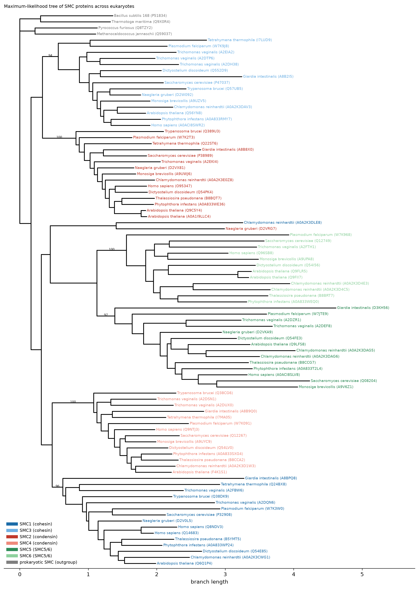
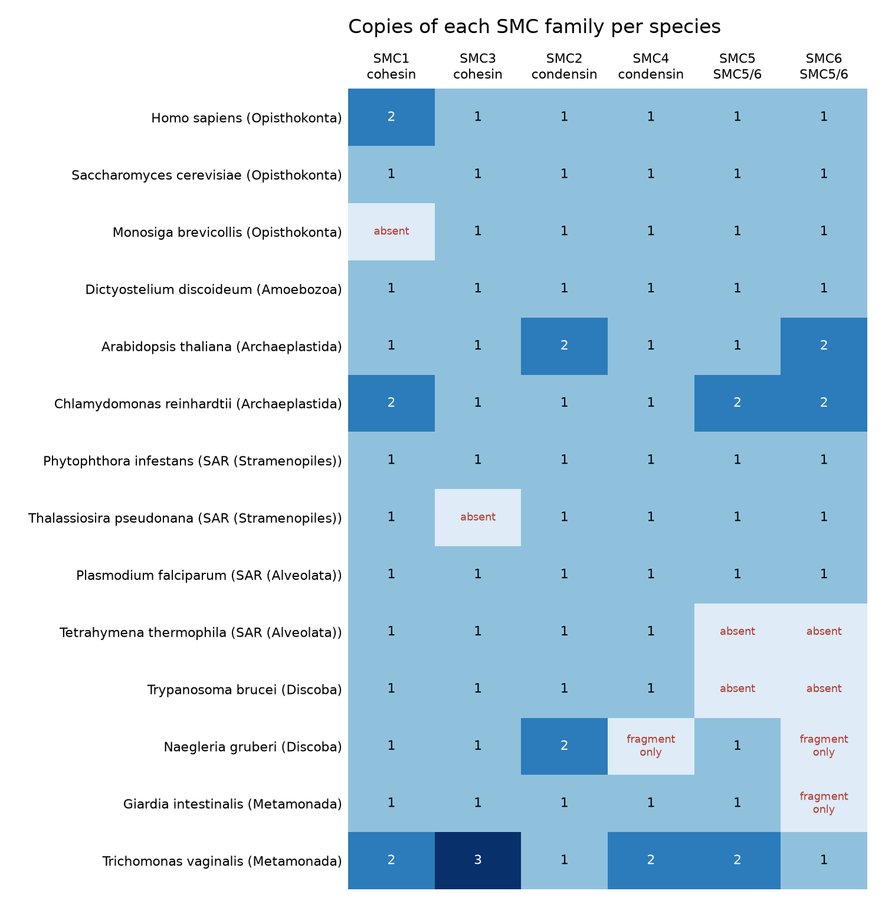

# smc-evolution

Evolution of SMC proteins, the motors that fold chromosomes, across the eukaryotic tree of life.

## Why SMC proteins

SMC (Structural Maintenance of Chromosomes) proteins form the core of three complexes that shape how chromosomes are folded in 3D:

| Complex | SMC pair | Main role |
| --- | --- | --- |
| Cohesin | SMC1 + SMC3 | holds sister chromatids together, forms loops and domains in interphase |
| Condensin | SMC2 + SMC4 | compacts chromosomes for cell division |
| SMC5/6 | SMC5 + SMC6 | DNA repair and genome stability |

Bacteria and archaea have a single SMC protein (or a distant relative such as MukB). Eukaryotes have six. Earlier work (for example Cobbe and Heck, 2004, *Mol. Biol. Evol.* 21:332) suggests that these six arose by gene duplications before the last eukaryotic common ancestor. Most of this evidence comes from model organisms such as yeast, animals and plants. I wanted to test it myself with a set of species that covers all major eukaryotic supergroups, including understudied unicellular eukaryotes, and to see whether any lineage has lost or duplicated an SMC family.

## Questions

1. Does each SMC family (SMC1 to SMC6) form one clade that contains all eukaryotic supergroups? This is what we expect if all six families were already present in the last eukaryotic common ancestor.
2. Which species have lost an SMC family, and which have extra copies?

## Approach

```
UniProt reference proteomes (14 eukaryotes, 6 supergroups)
   ▼
Similarity search: DIAMOND blastp (ultra-sensitive) against human and
   │  yeast SMC1-6 and RAD50; hits must cover the N- or C-terminal part
   │  of the ATPase head
   ▼
Labelling: best-hit family; ambiguous, fragment (< 700 aa) and
   │  redundant sequences removed (one record per gene,
   │  then >= 95% identical records collapsed)
   ▼
Alignment (MAFFT) → trimming (trimAl -automated1)
   ▼
Maximum-likelihood tree (IQ-TREE 2, ModelFinder, 1000 ultrafast bootstraps)
   │  rooted on prokaryotic SMC from 2 bacteria and 2 archaea
   ▼
Monophyly test per family + copy-number heatmap
```

The species are listed in [`config/species.tsv`](config/species.tsv). They include opisthokonts (human, budding yeast, the choanoflagellate *Monosiga*), amoebozoa (*Dictyostelium*), plants and algae (*Arabidopsis*, *Chlamydomonas*), stramenopiles (*Phytophthora*, the diatom *Thalassiosira*), alveolates (*Plasmodium*, *Tetrahymena*), discobans (*Trypanosoma*, *Naegleria*) and metamonads (*Giardia*, *Trichomonas*).

### Testing on simulated data first

Before using real data, I test the pipeline on simulated sequences where the true answer is known (`scripts/simulate_test_data.py`). An ancestral sequence evolves along a known history: six families arise by duplication before the species split, then each evolves along the same species tree. I added a simulated gene loss (SMC5 and SMC6 in *Giardia*), a duplication (SMC1 in *Tetrahymena*), a fragment, an N-terminally truncated gene model, extra isoforms of one gene, 200 unrelated background proteins per species, and a "coiled-coil" decoy that shares only the middle of an SMC protein. The pipeline passes when it finds and labels every SMC protein correctly, ignores the decoys, recovers all six families as clades, and finds the truncated protein, removes the isoforms, and finds the loss and the duplication.

## How to run

```bash
conda env create -f environment.yml
conda activate smc-evolution

./run_pipeline.sh --test     # simulated data, checks the results (about 15 min on 2 cores)
./run_pipeline.sh            # real data from UniProt
```

Use `THREADS=8 ./run_pipeline.sh` to use more CPU cores.

## Output

| File | Content |
| --- | --- |
| `results/classification.tsv` | every candidate protein with its label and scores |
| `results/smc_tree.png` | the rooted tree, coloured by family, support values at the base of each family |
| `results/family_monophyly.tsv` | per family: size of its main clade, bootstrap support, and sequences placed outside it |
| `results/copy_numbers.png` | copies of SMC1-6 in each species |
| `results/copy_numbers.tsv` | the same copy numbers as a table |

## Results

Run on 25 October 2026 with UniProt reference proteomes downloaded on 24 October 2026.

### All six SMC families go back to the last eukaryotic common ancestor



Each SMC family forms one strongly supported clade, and every clade contains species from all six supergroups, from humans to *Giardia*. If a family had appeared later, it would be limited to one branch of the eukaryotic tree.

| Family | Complex | Sequences | Species | Support of main clade (UFBoot) |
| --- | --- | --- | --- | --- |
| SMC1 | cohesin | 16 | 13 | 96 |
| SMC3 | cohesin | 15 | 13 | 94 |
| SMC2 | condensin | 16 | 14 | 100 |
| SMC4 | condensin | 14 | 13 | 100 |
| SMC5 | SMC5/6 | 14 | 12 | 97 |
| SMC6 | SMC5/6 | 12 | 10 | 100 |

The tree does not pair the families by complex. SMC1 (cohesin) groups with SMC4 (condensin), and SMC3 (cohesin) groups with SMC2 (condensin), while SMC5 and SMC6 group together. So cohesin and condensin did not each arise from one simple duplication. I still need to check the support for these deeper nodes and compare them with earlier studies.

Two sequences fall outside their family: *Chlamydomonas* A0A2K3DLE8 (labelled SMC1) and *Naegleria* D2VRG7 (labelled SMC2). They group with each other on a long branch. Both had only weak similarity to the reference SMC proteins, so they are probably divergent or misannotated proteins rather than true members of these families.

### Copy numbers and absences



Most species have exactly one copy of each family. Extra copies are found in humans (SMC1A and the meiosis-specific SMC1B), *Arabidopsis* (two SMC2 and two SMC6 genes) and *Trichomonas vaginalis* (extra copies of four families).

Some families were not found:

- SMC5 and SMC6 in *Tetrahymena* and *Trypanosoma*
- SMC3 in *Thalassiosira* and SMC1 in *Monosiga*
- full-length SMC4 and SMC6 in *Naegleria*, and SMC6 in *Giardia* (only fragments found)

Cohesin is essential for cell division, so a missing SMC1 or SMC3 most likely reflects a gap in the gene annotation, not a real loss. The missing SMC5/6 could be real gene losses or very divergent proteins. A direct search of the genome assemblies is needed to tell these apart (see Limitations).

### What I learned from the first runs

- My first version selected candidates by their Pfam annotation in UniProt. It missed many real SMC proteins, including yeast SMC6, because annotation is inconsistent across species. Searching whole proteomes by sequence similarity fixed this.
- The SMC ATPase head is built from both ends of the protein. Requiring a match to the N-terminal part only removed proteins whose gene models are truncated at the start (for example *Monosiga* SMC4). Accepting a match to either end recovered them.
- UniProt holds many records per human gene (isoforms and duplicate entries), which first gave nine human SMC5 "copies". Keeping one record per gene solved this.
- Annotation can be wrong: *Arabidopsis* F4K1S1 is annotated as "SMC3" in UniProt, but by sequence it is clearly SMC4.

## Limitations

- Classification by best BLAST hit against human and yeast proteins can fail for very divergent sequences. The tree is the real test: a protein that is labelled wrongly shows up inside another family's clade.
- An absent family can mean a real gene loss, or a gene that is missing from the proteome annotation. A next step would be to search the genome assemblies directly (for example with HMMER or tblastn) before calling a loss.
- One species per lineage gives a broad but thin sample.

## Repository layout

```
config/species.tsv              species, taxon IDs and supergroups
run_pipeline.sh                 runs all steps
scripts/01_fetch_uniprot.py     download proteomes, references and outgroups
scripts/02_classify.py          find and label SMC proteins with DIAMOND
scripts/03_plot_tree.py         root the tree, test monophyly, draw the tree
scripts/04_presence_absence.py  copy-number table and heatmap
scripts/simulate_test_data.py   simulated data with a known answer
scripts/check_test_results.py   compares test output with the truth
```

## Author

Nargess Sarmadfar ([github.com/nsarmadfar](https://github.com/nsarmadfar))
